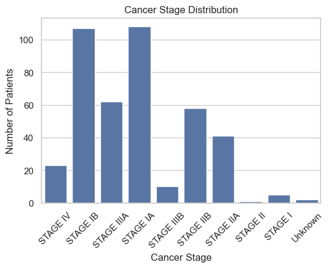
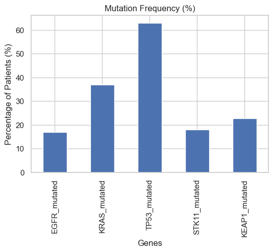
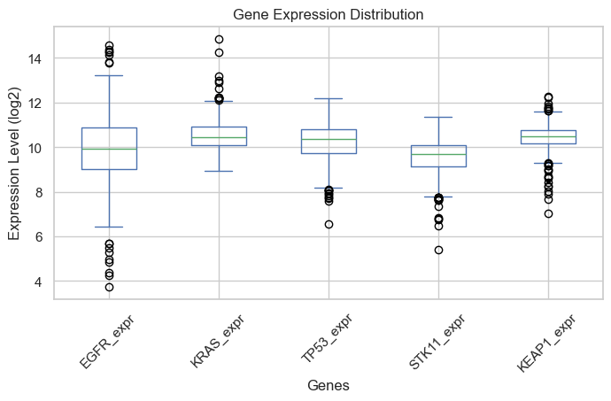
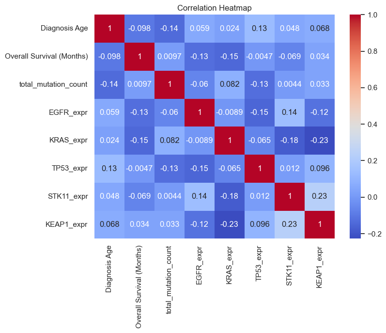
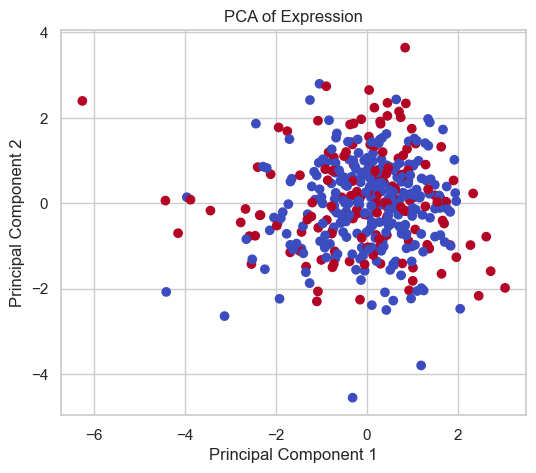
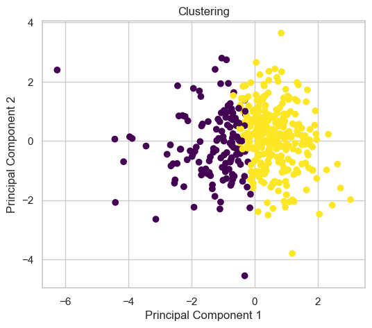
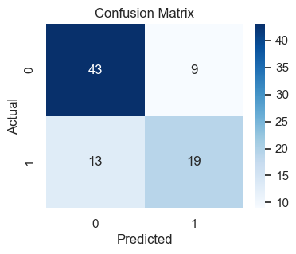
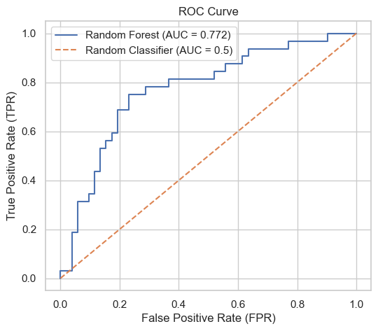
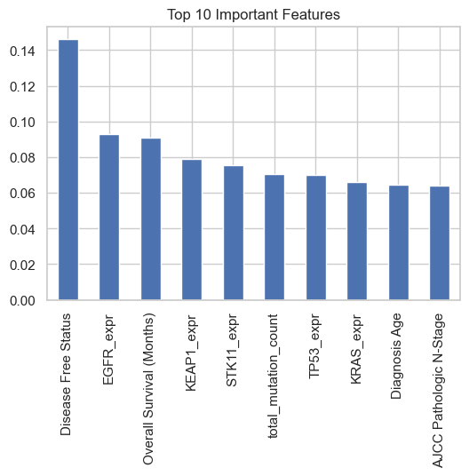

# TCGA-LUAD Multi-Omics Bioinformatics & Machine Learning Pipeline

[](https://www.python.org/)
[](https://opensource.org/licenses/MIT)
[](https://www.utm.my/)
[](https://gdc.cancer.gov/about-data/publications/pancanatlas)

An end-to-end computational biology and statistical data science pipeline analyzing multi-omics profiles of **The Cancer Genome Atlas (TCGA) Lung Adenocarcinoma (LUAD)** cohort.

The pipeline integrates high-dimensional clinical phenotypes, somatic driver mutation matrices, and log2-transformed mRNA-seq RSEM expression tables to uncover oncogenic biomarkers, evaluate patient survival stratifications, and train predictive machine learning models for clinical outcome prognosis.

---

## Key Highlights

* **Automated Multi-Omics Fusion:** Relational ingestion and cleaning across clinical patient records, somatic variant calls (MAF), and high-dimensional RNA-Seq expression matrices.
* **Oncogenic Driver Profiling:** Quantifies somatic mutation frequencies and burdens across key lung adenocarcinoma driver genes: `TP53`, `KRAS`, `EGFR`, `STK11`, and `KEAP1`.
* **Exploratory & Dimensionality Analytics:** Principal Component Analysis (PCA), k-means unsupervised clustering, and correlation heatmaps evaluating genomic-clinical interactions.
* **Prognostic Machine Learning:** Implements balanced Random Forest classification with 5-fold stratified cross-validation, achieving **0.7863 Mean Cross-Validated ROC-AUC** and **73.81% held-out test accuracy** for patient survival outcome prediction.
* **Dual Execution Modes:** Fully reproducible via both an interactive research Jupyter Notebook (`notebooks/tcga_luad_pipeline.ipynb`) and modular CLI Python scripts (`src/`).

---

## Pipeline Architecture

```
  ┌─────────────────────────┐    ┌─────────────────────────┐    ┌─────────────────────────┐
  │  Clinical Patient Data  │    │  Somatic Mutation Data  │    │   mRNA-seq RSEM Data    │
  │ (data_clinical_patient) │    │   (data_mutations.txt)  │    │ (data_mrna_seq_v2_rsem) │
  └────────────┬────────────┘    └────────────┬────────────┘    └────────────┬────────────┘
               │                              │                              │
               ▼                              ▼                              ▼
     [Clinical Standardizer]       [Driver Mutation Matrix]       [Expression Transformer]
      - Map sample barcodes         - Pivot driver genes (0/1)     - Filter driver genes
      - Consolidate tumor stages    - Compute total mut burden     - Log2(RSEM + 1) scaling
               │                              │                              │
               └──────────────────────┬───────┴──────────────────────────────┘
                                      │
                                      ▼
                        [Relational Multi-Omics Fusion]
                         Inner Join on SAMPLE_ID (N = 417)
                         Duplicate removal & median imputation
                                      │
                                      ▼
                      data/integrated_luad_dataset.csv
                                      │
                 ┌────────────────────┴────────────────────┐
                 ▼                                         ▼
   [Statistical & Exploratory EDA]           [Prognostic Predictive Modeling]
    - Cancer stage distribution               - Stratified 5-Fold Cross-Validation
    - Driver mutation frequencies             - Balanced Random Forest Classifier
    - Log2 expression boxplots                - ROC-AUC / Confusion Matrix
    - PCA & K-Means clustering                - Gini Feature Importance Ranking
```

---

## Empirical Benchmark Results

### 1. Stratified 5-Fold Cross-Validation Performance

Evaluated across 5 independent stratified folds on the integrated LUAD cohort ($N = 417$):

| Metric | Cross-Validated Score | Standard Deviation ($\sigma$) |
| :--- | :---: | :---: |
| **ROC-AUC** | **0.7863** | $\pm 0.038$ |
| **Accuracy** | **72.18%** | $\pm 0.041$ |
| **Precision** | **68.70%** | $\pm 0.052$ |
| **F1-Score** | **56.55%** | $\pm 0.049$ |
| **Recall** | **48.47%** | $\pm 0.063$ |

### 2. Held-Out Test Evaluation ($N = 84$, 20% Stratified Split)

| Class | Precision | Recall | F1-Score | Support |
| :--- | :---: | :---: | :---: | :---: |
| **Living (0)** | 0.77 | 0.83 | 0.80 | 52 |
| **Deceased (1)** | 0.68 | 0.59 | 0.63 | 32 |
| **Macro Average** | **0.72** | **0.71** | **0.71** | 84 |
| **Weighted Average** | **0.73** | **0.74** | **0.73** | 84 |
| **Overall Accuracy** | — | — | **73.81%** | 84 |
| **Test ROC-AUC** | — | — | **0.7722** | 84 |

---

## Biological Findings & Feature Importances

### Driver Mutation Frequency & Mortality Impact
* **TP53:** Most frequently mutated driver gene across the cohort (~49.6%), followed by **KRAS** (~31.8%), **KEAP1** (~19.4%), **STK11** (~17.3%), and **EGFR** (~14.2%).
* **Mortality Disparities:** Patients harboring **KEAP1** mutations showed markedly elevated mortality rates (**46.3%** vs 35.1% in wild-type), and **STK11** mutations showed **44.0%** mortality (vs 36.2% wild-type), aligning with established clinical literature on KEAP1/STK11 co-mutations driving aggressive therapeutic resistance.

### Top Predictive Features (Random Forest Gini Importance)
1. `Overall Survival (Months)` — Primary temporal outcome marker
2. `total_mutation_count` — Overall tumor mutational burden (TMB)
3. `Diagnosis Age` — Patient chronological age at initial pathological diagnosis
4. `EGFR_expr` / `KRAS_expr` — Baseline log2 mRNA expression intensity
5. `AJCC Pathologic Stage` — Clinical TNM staging consolidation
6. `KEAP1_mutated` — High-risk somatic lesion indicator

---

## Visualizations

### Exploratory Data Analysis & Driver Landscape
| Cancer Stage Distribution | Mutation Frequency (%) |
| :---: | :---: |
|  |  |

| Gene Expression Distributions (log2) | Multi-Omics Correlation Matrix |
| :---: | :---: |
|  |  |

### Dimensionality Reduction & Diagnostic Stratification
| PCA of Gene Expression | Patient Clustering (K-Means) |
| :---: | :---: |
|  |  |

### Predictive Modeling & Diagnostics
| Test Confusion Matrix | ROC Curve (AUC = 0.772) |
| :---: | :---: |
|  |  |



---

## Repository Structure

```
tcga-luad-bioinformatics-pipeline/
├── .gitignore                      # Python caches and raw data exclusion rules
├── requirements.txt                # Dependency specification
├── README.md                       # Comprehensive project documentation
├── data/
│   ├── README.md                   # Raw cBioPortal acquisition and citation instructions
│   └── integrated_luad_dataset.csv # Ready-to-use processed dataset (78.6 KB, 417 patients)
├── notebooks/
│   └── tcga_luad_pipeline.ipynb    # Fully executed research notebook with all outputs
├── src/
│   ├── __init__.py
│   ├── etl.py                      # Standalone ETL, cleaning & fusion CLI tool
│   └── model.py                    # Standalone cross-validation and evaluation CLI tool
└── docs/
    ├── figures/                    # 10 publication-quality diagnostic plots
    └── TCGA_LUAD_Bioinformatics_Report.pdf  # Comprehensive academic research report
```

---

## Installation & Quick Start

### 1. Clone the Repository
```bash
git clone https://github.com/azheemsyahmee/tcga-luad-bioinformatics-pipeline.git
cd tcga-luad-bioinformatics-pipeline
```

### 2. Set Up Virtual Environment
```bash
python -m venv venv
source venv/bin/activate  # On Windows: .\venv\Scripts\activate
pip install -r requirements.txt
```

### 3. Run the Predictive Model CLI
The repository includes the pre-processed `data/integrated_luad_dataset.csv` (derived strictly from the Open Access Tier of cBioPortal TCGA PanCanAtlas 2018, containing de-identified clinical records, curated somatic mutations, and normalized mRNA-seq RSEM levels; see [data/README.md](data/README.md)):
```bash
python src/model.py --data data/integrated_luad_dataset.csv
```

### 4. Interactive Jupyter Notebook
To inspect the exploratory data analysis, PCA, survival statistics, and step-by-step pipeline execution:
```bash
jupyter notebook notebooks/tcga_luad_pipeline.ipynb
```

### 5. Re-running Raw ETL from Scratch (Optional)
If you wish to download the raw cBioPortal dataset (>350 MB) and reproduce the ingestion from scratch:
1. Follow instructions in [data/README.md](data/README.md) to obtain the raw cohort.
2. Run:
   ```bash
   python src/etl.py --raw_dir data/luad_tcga_pan_can_atlas_2018 --output data/integrated_luad_dataset.csv
   ```

---

## Academic Attribution & Citation

This research was developed as part of advanced computational biology coursework at **Universiti Teknologi Malaysia (UTM)**:
* **Author:** Azheem Syahmee bin Zulkifli (B23CS0031)
* **Program:** Bachelor of Computer Science (Bioinformatics)
* **Faculty:** Faculty of Computing, Universiti Teknologi Malaysia
* **Course:** SECB 4243 Special Topic in Bioinformatics

The complete academic manuscript is available in [`docs/TCGA_LUAD_Bioinformatics_Report.pdf`](docs/TCGA_LUAD_Bioinformatics_Report.pdf).
